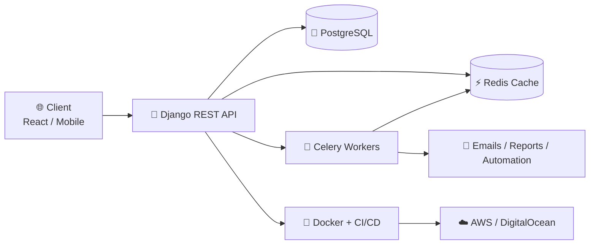

<!-- ✨ Muhammad Nouman | Animated Professional GitHub Profile -->

<!-- ═════════════ ANIMATED HEADER ═════════════ -->
<div align="center">


<a href="https://github.com/MuhammadNouman769">
  
</a>

<br/>


<a href="https://xveralabs.pythonanywhere.com/"></a>

</div>

<br/>

<!-- ═════════════ ABOUT ═════════════ -->
## 👨‍💻 About Me

<table>
<tr>
<td width="60%">

```python
class MuhammadNouman:
    role      = "Backend Engineer | Django, DRF & FastAPI"
    building  = "XVeraLabs (Custom Software, AI & Cloud)"
    open_to   = ["Full-time", "Freelance", "Remote"]
    location  = "Pakistan 🇵🇰"

    backend   = ["Python", "Django", "Django REST Framework",
                 "FastAPI", "GraphQL", "REST APIs"]
    data      = ["PostgreSQL", "MongoDB", "MariaDB",
                 "SQLite", "Redis"]
    async_    = ["Celery", "Redis Queues", "Background Jobs"]
    frontend  = ["React", "React Native", "HTMX",
                 "Alpine.js", "Tailwind", "Bootstrap"]
    devops    = ["Docker", "Docker Compose", "Linux", "AWS",
                 "DigitalOcean", "GitHub Actions (CI/CD)"]

    currently = "Deepening skills in AI / ML Engineering"
    focus     = ["Scalable APIs", "Async Workflows",
                 "Database Design", "Automation"]
    motto     = "Turn ideas into clean, maintainable, efficient code."

    def build(self):
        return "Production-ready solutions 🚀"
```

</td>
<td width="40%" align="center">


</td>
</tr>
</table>

<br/>

<!-- ═════════════ TECH STACK ═════════════ -->
## 🧠 Tech Stack

<div align="center">

**Backend**


**Frontend**


**DevOps, Cloud & Tools**


<br/>


</div>

<br/>

<!-- ═════════════ XVERALABS ═════════════ -->
## 🚀 XVeraLabs: My Software House

<div align="center">

<a href="https://xveralabs.pythonanywhere.com/">
  
</a>

*We build web, mobile, e-commerce and AI products for startups, SMEs and enterprises.*

<a href="https://xveralabs.pythonanywhere.com/">
  
</a>
<a href="https://xveralabs.pythonanywhere.com/contact/contact-us/">
  
</a>

<br/><br/>

<table>
<tr>
<td align="center" width="33%">

### 💻 Custom Software
Web apps, mobile apps, admin dashboards, APIs & integrations

</td>
<td align="center" width="33%">

### 🤖 AI & Automation
Chatbots, RAG knowledge assistants, AI agents & workflow automation (OpenAI, Claude, Gemini)

</td>
<td align="center" width="33%">

### ☁️ Cloud & DevOps
Migration, CI/CD, Docker & Kubernetes, monitoring, infrastructure as code

</td>
</tr>
<tr>
<td align="center">

### 🛒 E-Commerce
Online stores, marketplaces, recommendation engines

</td>
<td align="center">

### 📊 Data & Analytics
Dashboards, reporting, data engineering & scraping

</td>
<td align="center">

### 🧭 Consulting & MVPs
Product & tech strategy, MVP development, QA & testing

</td>
</tr>
</table>

**🔄 Our Process:** `Discover` → `Design` → `Build` → `Launch & Support`

</div>

<br/>

<!-- ═════════════ ARCHITECTURE ═════════════ -->
## 🏗️ How I Build Backends



<br/>

<!-- ═════════════ PROJECTS ═════════════ -->
## 🏆 Featured Projects

<div align="center">

<table>
<tr>
<td align="center" width="50%">

### 🏭 Electromechanica
Django website for a trusted Mechanical & Electrical Engineering company.

<br/>
<a href="https://github.com/MuhammadNouman769/onlineshowroom">

</a>

</td>
<td align="center" width="50%">

### 📰 Goallinereport
Scalable Django platform for stories & posts with Celery background tasks.

<br/>
<a href="https://github.com/MuhammadNouman769/Goallinereport">

</a>

</td>
</tr>
<tr>
<td align="center" width="50%">

### 🛒 BTR Mall
Full-stack E-commerce (B2B + B2C): Django REST API, React Web & React Native App.

<br/>
<a href="https://github.com/MuhammadNouman769/BTR-Mall">

</a>

</td>
<td align="center" width="50%">

### 🎨 Portfolio
Clean, professional personal portfolio & GitHub showcase.

<br/>
<a href="https://github.com/MuhammadNouman769/MuhammadNouman769">

</a>

</td>
</tr>
</table>

</div>

<br/>

<!-- ═════════════ STATS ═════════════ -->
## 📊 GitHub Analytics

<div align="center">


<br/>


<br/>


<br/>


</div>

<br/>

<!-- ═════════════ CONNECT ═════════════ -->
## 🤝 Let's Connect

<div align="center">

<a href="mailto:nomannisar769@gmail.com"></a>
<a href="https://www.linkedin.com/in/muhammad-nouman-524ab9360/"></a>
<a href="https://github.com/MuhammadNouman769"></a>
<a href="https://xveralabs.pythonanywhere.com/"></a>
<a href="https://wa.me/923285774948?text=Hello%20Nouman%2C%20I%20would%20like%20to%20connect%20with%20you!"></a>

<br/><br/>

> 💬 *"Build systems that scale, write code that lasts, and design logic that inspires."*

<br/>


</div>
