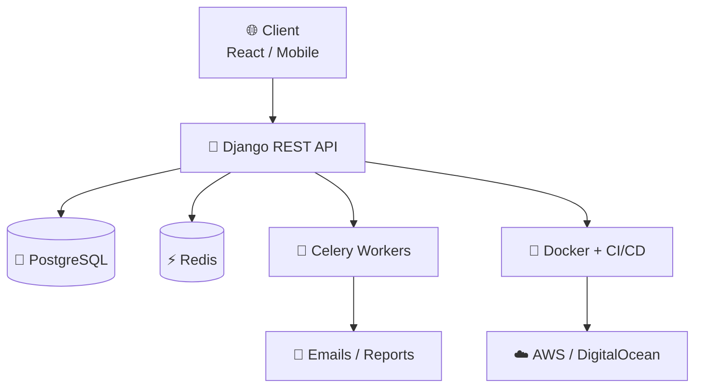

<!-- ✨ Muhammad Nouman | Mobile-First Animated GitHub Profile -->
<!-- NOTE: GitHub READMEs cannot use CSS media queries, so this layout is built mobile-first:
     single column, centered blocks, scalable images, no side-by-side tables. -->

<!-- ═════════════ HEADER ═════════════ -->
<div align="center">


<a href="https://github.com/MuhammadNouman769">
  
</a>

<br/>


<br/>
<a href="https://xveralabs.pythonanywhere.com/"></a>


<br/><br/>

<!-- App-style quick navigation -->
<a href="#about"></a>
<a href="#stack"></a>
<a href="#xveralabs"></a>
<a href="#projects"></a>
<a href="#contact"></a>

</div>

<br/>

<!-- ═════════════ ABOUT ═════════════ -->
<a name="about"></a>
<h2 align="center">👨‍💻 About Me</h2>

<div align="center">


</div>

```python
class MuhammadNouman:
    role = "Backend Engineer"
    stack = "Django | DRF | FastAPI"
    building = "XVeraLabs"
    open_to = ["Full-time",
               "Freelance", "Remote"]
    location = "Pakistan 🇵🇰"

    backend = ["Python", "Django", "DRF",
               "FastAPI", "GraphQL"]
    data = ["PostgreSQL", "MongoDB",
            "MariaDB", "SQLite", "Redis"]
    async_ = ["Celery", "Redis Queues"]
    frontend = ["React", "React Native",
                "HTMX", "Tailwind"]
    devops = ["Docker", "Linux", "AWS",
              "DigitalOcean", "CI/CD"]

    currently = "Learning AI / ML"
    focus = ["Scalable APIs", "Async",
             "DB Design", "Automation"]

    def build(self):
        return "Production-ready 🚀"
```

<div align="center">

> 💬 *"Turn ideas into clean, maintainable, efficient code."*

</div>

<br/>

<!-- ═════════════ TECH STACK ═════════════ -->
<a name="stack"></a>
<h2 align="center">🧠 Tech Stack</h2>

<div align="center">

**⚙️ Backend & Databases**


**🎨 Frontend**


**🛠️ DevOps, Cloud & Tools**


<br/>


</div>

<br/>

<!-- ═════════════ XVERALABS ═════════════ -->
<a name="xveralabs"></a>
<h2 align="center">🚀 Building XVeraLabs</h2>

<div align="center">

<a href="https://xveralabs.pythonanywhere.com/">
  
</a>

*Web, mobile, e-commerce and AI products for startups, SMEs and enterprises.*

<a href="https://xveralabs.pythonanywhere.com/">
  
</a>
<a href="https://xveralabs.pythonanywhere.com/contact/contact-us/">
  
</a>

<br/><br/>

**💻 Custom Software**<br/>
<sub>Web apps, mobile apps, dashboards, APIs & integrations</sub>

**🤖 AI & Automation**<br/>
<sub>Chatbots, RAG assistants, AI agents & workflow automation</sub>

**☁️ Cloud & DevOps**<br/>
<sub>Migration, CI/CD, Docker & Kubernetes, monitoring</sub>

**🛒 E-Commerce**<br/>
<sub>Online stores, marketplaces, recommendation engines</sub>

**📊 Data & Analytics**<br/>
<sub>Dashboards, reporting, data engineering & scraping</sub>

**🧭 Consulting & MVPs**<br/>
<sub>Product & tech strategy, MVP development, QA & testing</sub>

<br/>

`Discover` → `Design` → `Build` → `Launch & Support`

</div>

<br/>

<!-- ═════════════ ARCHITECTURE ═════════════ -->
<h2 align="center">🏗️ How I Build Backends</h2>



<br/>

<!-- ═════════════ PROJECTS ═════════════ -->
<a name="projects"></a>
<h2 align="center">🏆 Featured Projects</h2>

<div align="center">

### 🛒 BTR Mall
<sub>Full-stack E-commerce (B2B + B2C): Django REST API, React Web & React Native App</sub>

<br/>
<a href="https://github.com/MuhammadNouman769/BTR-Mall"></a>

---

### 📰 Goallinereport
<sub>Scalable Django platform for stories & posts with Celery background tasks</sub>

<br/>
<a href="https://github.com/MuhammadNouman769/Goallinereport"></a>

---

### 🏭 Electromechanica
<sub>Django website for a trusted Mechanical & Electrical Engineering company</sub>

<br/>
<a href="https://github.com/MuhammadNouman769/onlineshowroom"></a>

---

### 🎨 Portfolio
<sub>Clean, professional personal portfolio & GitHub showcase</sub>

<br/>
<a href="https://github.com/MuhammadNouman769/MuhammadNouman769"></a>

</div>

<br/>

<!-- ═════════════ STATS ═════════════ -->
<h2 align="center">📊 GitHub Analytics</h2>

<div align="center">


<br/>


</div>

<br/>

<!-- ═════════════ CONNECT ═════════════ -->
<a name="contact"></a>
<h2 align="center">🤝 Let's Connect</h2>

<div align="center">

<a href="mailto:nomannisar769@gmail.com"></a>
<a href="https://www.linkedin.com/in/muhammad-nouman-524ab9360/"></a>
<a href="https://github.com/MuhammadNouman769"></a>
<a href="https://xveralabs.pythonanywhere.com/"></a>
<a href="https://wa.me/923285774948?text=Hello%20Nouman%2C%20I%20would%20like%20to%20connect%20with%20you!"></a>

<br/><br/>

> 💬 *"Build systems that scale, write code that lasts, and design logic that inspires."*


</div>
